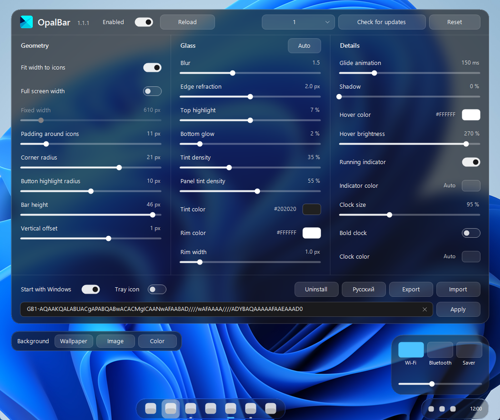

# OpalBar

Glass taskbar for Windows 11. Restyles the stock taskbar in place: floating rounded bar, blur, tint, matching flyouts.



Settings code from the screenshot, paste it into the settings field and press Apply:

```
GB1-AQAAKQALABUACgAPABQABwACACMgICAANwAFAA8AD////wAFAAAA////ADYBAQAAAAAFAAEAAAD0
```

## Install

Download `OpalBarInstall.exe` from [Releases](https://github.com/idLorem/OpalBar/releases) and run it. Settings open from the OpalBar shortcut on the desktop.

## Build

From an "x64 Native Tools" prompt (Visual Studio 2022, Windows SDK):

```
cmake -B build -G Ninja -DCMAKE_BUILD_TYPE=Release
cmake --build build
```

The result is `build/OpalBarInstall.exe`.
